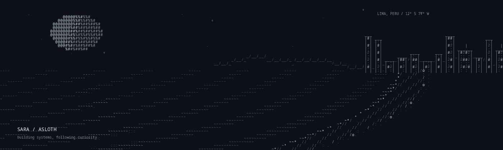

  

  <strong>Sara · asloth</strong> 
  AI agents, MLOps and data engineering 
  <a href="https://sara.coffee">sara.coffee</a> · <a href="#featured-work">Featured work</a>

I keep learning, I share what I know, and I try to leave things running better than I found them.

### Featured work

- **[ccdesk](https://github.com/asloth/ccdesk)**: an MCP server that lets Claude Code see and control Linux apps, on your screen or a private one.
- **[agent-researcher](https://github.com/asloth/agent-researcher)**: parallel research agents that search the web, index PDFs and return answers with citations to their sources.
- **[OpenRoutine](https://github.com/asloth/openroutine)**: an open-source app for timed daily routines that works offline, with optional Google Drive sync for your own data.
- **[mlops-recetas](https://github.com/asloth/mlops-recetas)**: a LoRA fine-tune that generates Latin American recipes, with MLflow experiment tracking and Airflow orchestration around it.

### What I work on

- **Agentic AI and MLOps**: research agents with LangGraph and LangSmith, QA workflows with the Google GenAI SDK, reproducible model lifecycles in MLflow.
- **Data engineering**: real-time transactional flows into Elasticsearch, large-scale ETL on Spark, Databricks and Airflow.
- **Architecture and automation**: automation and technical governance for banking, covering security, data privacy and operations.

### Stack

**AI / data:** LangChain · LangGraph · MLflow · Spark · Databricks · Airflow · dbt · Pandas · vector databases 
**Infra:** AWS · Azure · Docker · CI/CD · Git · n8n

---

  <a href="https://sara.coffee">sara.coffee</a>

